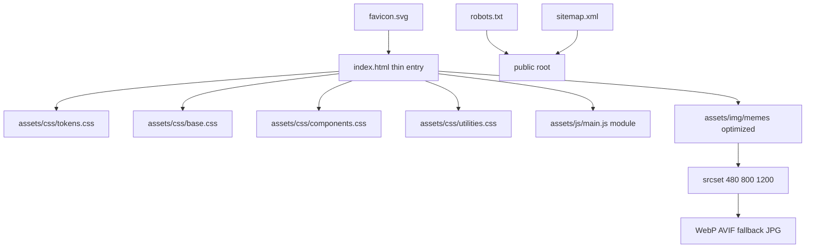

# Memdex — Technical Problems & Architecture Optimization Plan

Scope: [`index.html`](../index.html) (current version), legacy [`index.htm`](../index.htm), and the raw image assets in the project root.

---

## 1. Current state

| Item | Value |
|---|---|
| `index.html` | 1552 lines, single monolithic file (inline CSS ~1057 lines + inline JS) |
| `index.htm` | 1092 lines, older duplicate of the same landing page |
| Images | 6 files in project root, raw JPG/PNG, Cyrillic + spaced filenames |
| Build tooling | None |
| External dependencies | None (no fonts loaded, no CDN libs) |

---

## 2. Technical problems

### 2.1 Architecture & structure

- **P1 — Monolithic single file.** All CSS (~1065 lines) and JS are inlined in [`index.html`](index.html:8). Consequences: no caching of styles/scripts across page loads, bloated HTML payload, hard to maintain or reuse, no source maps, hard to lint/test.
- **P1 — Duplicate landing pages.** [`index.htm`](index.htm) and [`index.html`](index.html) are two versions of the same page. Depending on the host, the wrong one may be served (e.g., IIS prefers `index.htm`); they will drift apart. Risk of duplicate-content SEO penalty.
- **P2 — No asset organization.** Images sit in the project root next to source files; no `assets/`, `img/`, `css/`, `js/` separation.

### 2.2 Images (biggest performance & robustness risk)

- **P1 — Non-ASCII filenames with spaces** (e.g. `src="когда пошутил как верити.jpg"` at [`index.html`](index.html:1262), `"старый бог.jpg"` at [`index.html`](index.html:1372), `"Photos_vxDL54ayds.png"` at [`index.html`](index.html:1350)). Must be URL-encoded to work reliably; breaks on some CDNs/caching layers and is hostile to source control.
- **P1 — No width/height attributes and no responsive images.** No `srcset`/`sizes`; the browser downloads full-resolution files for a ~260–400 px card. CLS is only partially mitigated by the `aspect-ratio: 4 / 3` on `.meme-image` ([`index.html`](index.html:627)).
- **P2 — No modern formats.** All content is JPG/PNG; no WebP/AVIF, which would cut weight ~30–60%.
- **P2 — `loading="lazy"` on every image** ([`index.html`](index.html:1265)), including the first meme near the top; the LCP image should be `eager` with `fetchpriority="high"`.
- **P2 — No preload / no image CDN strategy.** With a "comics/meme archive" concept, images will dominate payload; a strategy (local pipeline now, CDN later) is needed.

### 2.3 HTML validity, semantics & navigation

- **P1 — Dead anchor `#random`.** Nav links point to `#random` ([`index.html`](index.html:1082), [`index.html`](index.html:1102), [`index.html`](index.html:1493)) but no element with `id="random"` exists. Clicking does nothing / jumps to top. Also `#categories` and `#top` are fine, `#about` reuses the "How it works" section.
- **P2 — `cursor: pointer` on non-interactive cards.** `.category-card` ([`index.html`](index.html:556)) and `.meme-card` ([`index.html`](index.html:613)) signal clickability but have no handler, no `role`, and are not keyboard-focusable.
- **P2 — Decorative "share" affordance without action.** `.meme-share` `↗` ([`index.html`](index.html:1276)) is `aria-hidden` but visually implies an action that does not exist.
- **P2 — Missing `<meta name="description">`, Open Graph / Twitter Card tags, canonical URL, structured data.** Title is set; that's all.
- **P2 — Social/footer links all `href="#"`** ([`index.html`](index.html:1511)).

### 2.4 Accessibility

- **P1 — Mobile menu is not an accessible dialog.** No focus trap, no Escape-to-close, no `inert` on the rest of the page, `aria-expanded` is set but no `aria-controls` consistency; menu is a duplicate `<nav>` with the same links as the header ([`index.html`](index.html:1098)).
- **P1 — Menu resize bug.** If the menu is opened on mobile and the viewport is resized above 1024 px, `.mobile-menu` becomes `display:none` but `document.body.style.overflow` stays `hidden` (set at [`index.html`](index.html:1537)) — the page becomes unscrollable with no way to close the menu.
- **P1 — Contrast failures.** `--text-dim: #9a9a9a` on `--bg-card: #f5f5f5` (e.g. `.category-count` [`index.html`](index.html:596)) ≈ 2.4:1; `--text-muted: #6b6b6b` on light cards ≈ 4.5:1. Both fail WCAG AA for small text.
- **P2 — Visually-hidden label via inline style.** The email label uses an inline style at [`index.html`](index.html:1455) instead of a reusable `.visually-hidden` utility.
- **P2 — No `<html>` heading-to-section label mismatch.** Section `id="about"` is labelled by `aria-labelledby="how-title"` — works, but the id/name mismatch is confusing; recommend renaming the section id to `how-it-works`.
- **P3 — `filter: grayscale(...)` applied to emoji text** ([`index.html`](index.html:450), [`index.html`](index.html:578)) triggers expensive text re-rasterization on hover.

### 2.5 CSS quality & performance

- **P1 — `transition: all` everywhere.** `.btn`, `.meme-card`, `.stat-card`, `.category-card`, `.social-link`, `.meme-share`, `.meme-image`, `.meme-img` all use `transition: all var(--transition)` with a back-out ease ([`index.html`](index.html:34)). Animating `all` causes layout/paint work (box-shadow, border-color, filter) on every hover.
- **P2 — Heavy `backdrop-filter: blur(12px)`** on the sticky header ([`index.html`](index.html:223)) — a known cost on low-end mobile; should be gated or simplified.
- **P2 — Expensive static paint.** Triple `text-shadow` on `h1` ([`index.html`](index.html:89)) and `filter` on hero sparks/emoji — one-time cost, but should be avoided in animations.
- **P2 — Fonts referenced but never loaded.** `--font-body: 'Inter', ...` and `--font-head: 'Impact', ...` ([`index.html`](index.html:38)) — `Inter` is never fetched; design intent silently falls back to `Segoe UI`. Either load the font or remove the dead reference.
- **P3 — No CSS containment (`contain`/`content-visibility`)** to limit layout/paint scope for below-fold sections.
- **P3 — No print stylesheet; emoji icons used in place of an icon font/SVG sprite** (ok for a meme site, but inconsistent sizing on some platforms).

### 2.6 JavaScript

- **P2 — Inline event handler on form.** `onsubmit="event.preventDefault(); this.reset();"` ([`index.html`](index.html:1454)) — no validation feedback, no network call, mixed with inline `<script>`; hard to test.
- **P2 — Menu logic gaps** (see 2.4): no Escape, no focus management, no resize guard, no `matchMedia` handling.
- **P3 — No use of `requestAnimationFrame`/passive listeners; script is a single IIFE** — fine for now, but should become a module for testability.

### 2.7 SEO & distribution

- **P2 — No `robots.txt`, no `sitemap.xml`, no canonical, no structured data** (e.g. WebSite/ItemList for the meme catalog).
- **P3 — Duplicate `index.html`/`index.htm`** compounds SEO issues.

---

## 3. Target architecture

Goal: keep it a fast, dependency-free static site, but structured so it can grow (or be wrapped by a static-site generator later).



Proposed structure:

```
megakrutoy-site/
├── index.html                # thin: semantic markup + link to css/js
├── favicon.svg
├── robots.txt
├── sitemap.xml
├── assets/
│   ├── css/
│   │   ├── tokens.css        # design tokens (keep :root vars)
│   │   ├── base.css          # reset, typography, utilities
│   │   ├── layout.css        # header, hero, footer, containers
│   │   └── components.css    # cards, buttons, forms, menu
│   ├── js/
│   │   └── main.js           # ES module: menu, form, share
│   └── img/
│       ├── memes/            # webp/avif + jpg fallback per meme
│       └── og-cover.jpg
```

Decisions:
- **No build step by default** — plain static HTML/CSS/JS, version-agnostic, opens anywhere.
- **Optional Vite/11ty upgrade path** if the catalog grows into multiple pages / a data-driven meme list (data in `memes.json`, cards rendered from template).
- **CSS:** keep CSS custom properties as the token system (already good); group into files by concern.
- **JS:** one ES module `main.js`; event delegation; `matchMedia` for menu; `prefers-reduced-motion` respected (already present in CSS).
- **Images:** rename to ASCII slugs (`veriti.jpg`, `irkutsk.jpg`, `mellstroy.jpg`, `dzhigan.jpg`, `ivangay.jpg`, `staryi-bog.jpg`), resize to the rendered size, export WebP (and AVIF where supported), provide JPG fallback, `srcset`/`sizes`, `width`/`height`, `fetchpriority` on the first meme.

---

## 4. Implementation phases (todo)

1. **Consolidate** — delete/archive `index.htm`; create `assets/css/*` and `assets/js/`; split the inline `<style>` and `<script>` into those files; link them from `index.html`.
2. **Assets & images** — rename files to ASCII slugs; resize/convert to WebP/AVIF with JPG fallback; add `srcset`/`sizes`, `width`/`height`, `fetchpriority`/`loading`.
3. **Navigation** — add a real `#random` target (or remove the link); give sections stable ids (`#how-it-works`); single source for nav links (data-driven menu rendered by JS, or keep static and deduplicate).
4. **Menu refactor** — accessible dialog behavior: Escape close, focus trap, `inert` background, resize guard that restores scroll, consistent `aria-*`.
5. **Form** — real submit handler with email validation, loading/disabled state, success/error message (no backend: simulate + instruct, or wire to a Formspree-style endpoint if provided); remove inline `onsubmit`/style.
6. **Semantics & a11y** — add `.visually-hidden` utility; fix contrast tokens (raise `--text-dim`/`--text-muted` on light surfaces); make interactive cards real `<a>`/`<button>` or remove fake affordances; keep heading order h1→h2→h3.
7. **SEO/metadata** — meta description, OG/Twitter, canonical, JSON-LD (WebSite + ItemList), `robots.txt`, `sitemap.xml`.
8. **CSS perf** — replace `transition: all` with targeted properties; add `contain: content`/`content-visibility: auto` on below-fold panels; reduce `filter` usage in animations; load or drop `Inter`; gate `backdrop-filter`.
9. **Verification** — Lighthouse (Perf/A11y/SEO/Best Practices), HTML validator, test at 375/768/1024/1440 px and with `prefers-reduced-motion`.

---

## 5. Out of scope (recommended later)

- Real backend / database for memes and likes
- User accounts, upload flow
- Image CDN (Cloudflare R2/Imgix) and real analytics
- Multi-page routing / static-site generator migration
